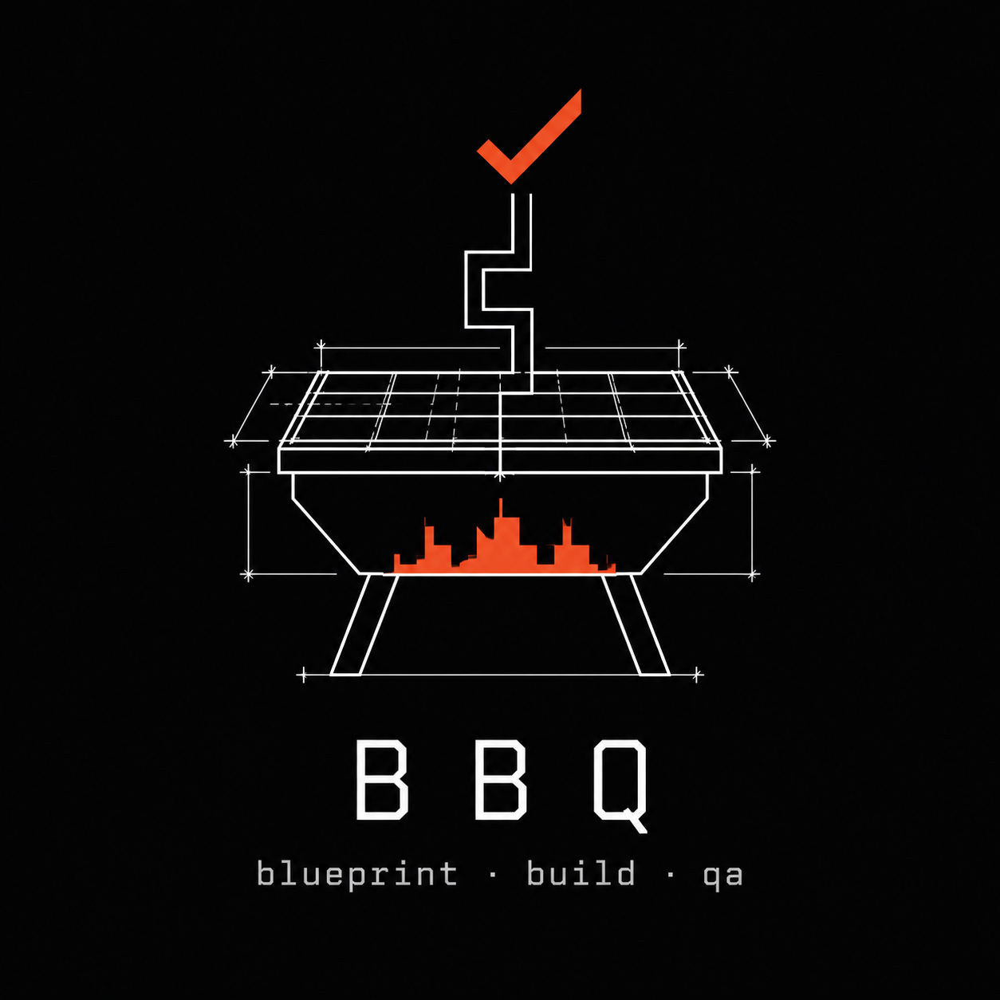

# vpaivag/skills

Personal collection of agent skills covering planning, code review, repo setup, and onboarding workflows.

Each skill is a self-contained `SKILL.md` under `skills/<name>/` that loads on demand when its trigger fires. The planning skills compose into the **BBQ flow** — **B**lueprint → **B**uild → **Q**A:

```mermaid
flowchart TD
    plan[/blueprint/]
    execute[/build/]
    qa[/qa/]
    adv[/adversarial-review/]

    plan -->|"plan.md · fresh session, sonnet"| execute
    execute -->|"qa-plan.md · fresh session, blind to the plan"| qa
    qa --> adv

    gaps(gap-finder ×4)
    author(qa-author)

    plan -.goldfish review of plan.md.-> gaps
    plan -.authors qa-plan blind.-> author

    classDef helper fill:#f5f5f5,stroke:#999,stroke-dasharray:4 3,color:#555
    class gaps,author helper
```

`/blueprint` is the single front door: it sizes the task, interviews you for edge cases and decisions, has blind goldfish review the plan cold, and produces a suite — `context.md`, one executable `plan.md`, a `qa-plan.md` authored **blind** from intent alone, and a `visual.html` review surface (rendered by a script, no agent) where you approve or flag the plan in your browser. Execution and QA then run in fresh sessions with deliberately separated knowledge: the executor never does behavioral QA, and QA never sees the plan.

## Contents

- [Install](#install)
  - [Via the skills CLI](#via-the-skills-cli)
  - [As a Claude Code plugin](#as-a-claude-code-plugin)
- [Skills](#skills)
  - [Planning](#planning)
    - [blueprint](#blueprint)
    - [build](#build)
    - [qa](#qa)
  - [Product](#product)
    - [issue](#issue)
    - [project](#project)
  - [Repo setup](#repo-setup)
    - [setup](#setup)
    - [claude-md-refactor](#claude-md-refactor)
  - [Onboarding](#onboarding)
    - [onboarding](#onboarding-1)
  - [Review](#review)
    - [intent-review](#intent-review)
    - [adversarial-review](#adversarial-review)
    - [pattern-review](#pattern-review)
- [Agents](#agents)
- [Layout](#layout)
- [Contributing](#contributing)

## Install

Pick the path that matches your setup:

### Via the skills CLI

Manually add the skills to any agent using the [skills CLI](https://github.com/vercel-labs/skills).

Install all skills:

```bash
npx skills@latest add vpaivag/skills
```

Install a specific skill:

```bash
npx skills@latest add vpaivag/skills --skill blueprint
```

Target a specific agent (e.g. Claude Code):

```bash
npx skills@latest add vpaivag/skills -a claude-code
```

Note: the CLI installs skills only — the declared agents (`gap-finder`, `qa-author`) and the visual renderer ship with the Claude Code plugin, so `/blueprint`'s subagent stages and `visual.html` need the plugin install below.

### As a Claude Code plugin

This repo is a Claude Code plugin marketplace. Run each command on its own line at the Claude Code prompt:

```
/plugin marketplace add vpaivag/skills
```

```
/plugin install skills@vpaivag
```

```
/reload-plugins
```

The first command registers the marketplace (named `vpaivag`) by fetching `.claude-plugin/marketplace.json` from this repo. The second installs the `skills` plugin from it. The third activates the plugin in your current session — without a restart.

Verify it's registered:

```
/plugin marketplace list
```

If `/plugin install skills@vpaivag` returns `Marketplace "vpaivag" not found`, the `marketplace add` step didn't complete — re-run it and check the output.

Update later:

```
/plugin marketplace update vpaivag
```

Or use a local clone instead of GitHub:

```
/plugin marketplace add /absolute/path/to/skills
```

## Skills

### Planning

<p align="center">
  
</p>

#### blueprint

**Trigger:** `/blueprint <task or issue>`, or asking to plan a task or feature, blueprint an issue, or gather context before implementation.

The single planning front door. One conversational session — the **elephant**, which holds every decision — takes a task from stated intent to an approved suite:

- **Size first** — too small or a direct fix, and it says so ("we'd be overthinking this") and offers to implement directly; you can always force the plan. More than one independently shippable unit, and it recommends splitting into one issue and one blueprint per unit.
- **Interview** — unless the conversation already holds the discussion (you grilled first), it grills you itself using a vendored copy of [mattpocock/skills](https://github.com/mattpocock/skills)' `grilling` (MIT): numbered rounds, a recommended answer per question, facts looked up rather than asked. Done when expected behavior, edge cases, scope, and every real decision can be stated without guessing.
- **Goldfish review** — four blind `gap-finder` agents read only `plan.md`, one lens each (edge & failure, scope & ambiguity, users & data, comprehension), and return the questions a cold reader is left with. The elephant triages them under strict rules — "it was intentional" is not evidence — and routes each answer to `context.md` (intent) or `plan.md` (plan).
- **Blind QA, agent-free render** — `qa-author` writes `qa-plan.md` from the settled `context.md` only; `render.sh` turns the suite markdown into `visual.html` with no agent.

The suite:
- `context.md` — intent and implementation-free expected behavior (`EB-n`)
- `plan.md` — one executable plan: decisions, files, phases, risks, mechanical `AC-n`; interfaces and intent, never implementation bodies; zero design decisions left to the executor
- `qa-plan.md` — behavioral criteria authored blind, before and without ever seeing the plan
- `visual.html` — decisions, file map, phases, risks, an optional architecture diagram, and the QA coverage map. Approve or flag sections in the browser; the verdict comes back via `review.json` (File System Access API) or copy-paste. Sections that break their format render raw under a warning instead of disappearing.

Run it on a strong model (Opus or Fable) — the handoff commands it prints pin Sonnet for the downstream sessions.

→ [`skills/blueprint`](./skills/blueprint)

#### build

**Trigger:** `/build <suite-dir>` (or the `plan.md` path directly).

Executes the suite's single `plan.md` in a fresh session: read the plan first, confirm with you, implement the phases in order with a checkpoint line at each boundary, then walk the mechanical `AC-n` acceptance criteria (✅/❌ — never claims completion with a ❌). Ends by printing the `/qa` handoff; it never runs behavioral QA itself, because a session that just implemented the code is the wrong judge of whether the code does what was asked.

`/blueprint` prints the exact command with the model baked in: `claude --model sonnet "/build <suite-dir>/plan.md"`.

→ [`skills/build`](./skills/build)

#### qa

**Trigger:** `/qa <suite-dir>`, or asking to "verify the intent" / "test what we asked for, not what we built".

Verifies behavioral intent in a **plan-blind** session: it reads only `qa-plan.md` (and `context.md`) — never `plan.md`, `visual.html`, or the diff — and checks each criterion against the running code from the outside, the way a user would. If the repo has a test setup, criteria become real test files following the repo's conventions, annotated with their `B-n`/`R-n` IDs; if not, criteria are verified live and reported as a manual checklist. Failures are reported as expected-vs-observed divergence, never "fixed" here and never diagnosed by peeking at the implementation.

→ [`skills/qa`](./skills/qa)

### Product

#### issue

**Trigger:** `/issue <rough input>`, or asking to write, create, or file a Linear issue or ticket, turn a bug report or feature idea into a ticket, or break a feature into sub-issues.

Drafts Linear issues that a dev or coding agent can pick up cold — the issue is the whole brief, no conversation behind it. One standard format for every type (`ISSUE-FORMAT.md`): a verb-first title, then **Context → Acceptance → Out of scope → Pointers → References**, with only the section content changing between bugs, features, parents, and sub-issues.

- **Language per issue** — asked once in a single batch with the team and any gaps; headings stay in English so every issue shares the same skeleton.
- **Shapes the work** — one feature is one issue, however long it takes: a bug or single-layer change is one issue; a feature needing multiple steps, layers, or repos becomes a parent with one sub-issue per layer, the contract layer **blocking** its consumers. Relations go in Linear's fields, not prose. Two or more features toward one goal are project-sized — flagged and sent to `/project`.
- **Speaks Linear** — issue, sub-issue, project, cycle, relation; never Jira/Scrum terms.
- **Checks before drafting** — searches Linear for duplicates and blockers, and the current repo for real file pointers.
- **Writes only after approval** — shows a full preview, then creates through the Linear MCP. Never sets estimates.

Needs the Linear MCP connected.

→ [`skills/issue`](./skills/issue)

#### project

**Trigger:** `/project <rough input>`, or asking to create or spec a Linear project, turn a set of related features into a project, or when `/issue` flags work as project-sized.

Drafts a Linear project the team can plan against — the project says what and why, the issues say how. One standard format (`PROJECT-FORMAT.md`): a noun-phrase name and one-line summary, then **Problem → Goal (with a success signal) → Scope → Out of scope → Risks → References**.

- **Gated by features, not duration** — a project holds two or more features toward one goal; a single feature, however big, is sent back to `/issue`.
- **Scope lists features** — each one becomes an `/issue` run. Milestones are optional, used only when features ship in stages, and always name a shippable outcome, never a layer or phase.
- **Checks before drafting** — searches Linear for overlapping projects, a matching initiative, and open issues that already cover a feature.
- **Writes only after approval** — shows a full preview, creates the project and milestones through the Linear MCP (never from a Linear template), then invokes `/issue` for every feature.

Needs the Linear MCP connected.

→ [`skills/project`](./skills/project)

### Repo setup

#### setup

**Trigger:** `/setup` or asking to configure where plans live, set up the plans directory, or whether plans should be gitignored.

Writes a small `.claude/plans-config.json` that the planning skills (`/blueprint`, `/build`, `/qa`) consult to find the plans directory. Drives a short Q&A (where plans should live, whether to gitignore them), then writes at most two files: `.claude/plans-config.json` and — if opted in — an entry in `.gitignore`. Planning skills fall back to `.claude/plans` when the config is absent, so running `/setup` is optional.

→ [`skills/setup`](./skills/setup)

#### claude-md-refactor

**Trigger:** mentions of `CLAUDE.md` being too long, bloated, eating context, or asks to set up / audit / split / restructure a `CLAUDE.md` (or `AGENTS.md`-style instructions).

Refactors, audits, or bootstraps a repository's `CLAUDE.md` so it stays a lean **index of pointers** to `/docs/<topic>.md` files instead of bloating every session's context. Applies progressive disclosure: short root file, detail loaded on demand.

Three modes:
- **Audit** an existing `CLAUDE.md` and split it.
- **Bootstrap** a `CLAUDE.md` + `/docs` for a repo that has none.
- **Confirm** a healthy `CLAUDE.md` doesn't need changes (avoids over-editing).

→ [`skills/claude-md-refactor`](./skills/claude-md-refactor)

### Onboarding

#### onboarding

**Trigger:** `/onboarding` or asking for a guided tour of a new codebase / help onboarding.

Ramps a newcomer up on an unfamiliar codebase in three phases: a `CLAUDE.md`-quality gate, a conversational tour driven by `CLAUDE.md` and the docs it points at, and a single contrived hands-on task written to `.claude/onboarding-task.md` so the newcomer can implement it themselves on a sandbox branch. Read-only on the codebase during the tour; writes exactly one artifact. Needs a healthy `CLAUDE.md` to be worthwhile — aborts with a pointer to `/claude-md-refactor` (bootstrap mode) if it's missing, and warns + offers an override if it looks thin.

→ [`skills/onboarding`](./skills/onboarding)

### Review

A PR review is three questions, each asked by a skill with its own blindness: `/intent-review` — *is it what was asked?* (sees the request, never the author's story) — `/adversarial-review` — *is it broken?* (sees the diff, never the intent) — and `/pattern-review` — *does it fit the repo?* (conventions are mined from existing code by agents that never see the diff). All run in a fresh session.

#### intent-review

**Trigger:** `/intent-review <diff> [request]`, or asking whether a PR or branch does what the issue asked, to check a diff against the request or its acceptance criteria, or "did this miss anything?".

Checks that a diff delivers **what was requested** — every ask, every constraint, nothing silently dropped or reinterpreted. The request is a Linear issue, a `context.md`, or the prompt pasted in; with none given it follows an issue linked from the PR, or asks. The PR description and commit messages are the **author's story** — they narrate what the author believes they built, so they're never used as the request and never reach a subagent.

- **Asks first, confirmed by you** — a subagent that sees only the request breaks it into numbered asks (`I-n`), constraints (`C-n`), and ambiguities; you approve the list before anything is traced.
- **Traced with evidence** — 2+ independent tracers give every ask a verdict (**done / partial / missing / drifted**) and every constraint **respected / violated**, each with `file:line`, then sweep for unrequested changes (**supporting** vs **unrelated**).
- **Verified, then reported** — every gap and every tracer disagreement is re-checked against the real code. Report only: no fixes, no PR comments.

→ [`skills/intent-review`](./skills/intent-review)

#### adversarial-review

**Trigger:** asking for an adversarial review, to stress-test a diff for bugs, "tear this apart", "assume it's broken", "poke holes in this", "red-team this code", or a skeptical second pass on code that was just written.

Adversarial code review built on **split context**, faithful to the [Bun-in-Rust flow](https://bun.com/blog/bun-in-rust#adversarial-review). The Claude that wrote the code wants it accepted, so it's a poor judge of its own work. This skill delegates the reviewing to fresh subagents that see **only the diff** — never the plan or the author's reasoning — and are told to assume the code is wrong and find why. Every suspected defect is then verified against the real code before it reaches you, so the aggressive framing doesn't flood you with false positives.

- **Reviewers see the diff, not the story** — leaking intent is what launders a bug into "looks fine".
- **Report by default** — fixes are applied only if you ask after seeing the findings.

The intent-blind counterpart to `intent-review`; the natural last step of the planning pipeline, and the lightweight local counterpart to `/code-review ultra`.

→ [`skills/adversarial-review`](./skills/adversarial-review)

#### pattern-review

**Trigger:** `/pattern-review [diff]`, or asking whether a PR or diff follows the repo's patterns or conventions, "is this how we do it here?", or to catch reinvented helpers.

Checks that a diff **looks like the repo it lands in** — error handling, naming, placement, test shape, and existing helpers reused instead of rewritten. Not bugs, not fit to the request: only consistency with what the repo already does.

- **Mined blind** — each changed unit is described without its code; miner subagents that never see the diff extract the repo's conventions for that kind of unit from the base ref (edited files count in their pre-change form, new files never), plus the helpers that already do its job.
- **Family first** — a unit is judged against its nearest siblings before the repo as a whole, so a family that does things its own way isn't flagged for it.
- **A pattern needs 2+ examples** — every convention cites at least two `file:line` examples (or a documented rule in `CLAUDE.md`; a one-member family counts as sibling precedent); where the repo already does it two ways, that's a split, not a finding.
- **Compared, verified, reported** — 2+ comparers flag **deviations**, **reinvented helpers**, and deliberate **new patterns** (grouped as one finding, not one per site); every finding is re-checked against the real code. Report only.

→ [`skills/pattern-review`](./skills/pattern-review)

## Agents

The plugin ships two declared agents under `agents/`, spawned by `/blueprint` (and invocable directly). Each carries its expertise in its own system prompt and pins the model that fits its role:

| Agent | Model | Role | Deliberately blind to |
|---|---|---|---|
| `gap-finder` | sonnet | Goldfish review of `plan.md` through one lens (edge-failure, scope-ambiguity, users-data, comprehension); returns questions, never answers | the conversation, `context.md`, the codebase, the other lenses |
| `qa-author` | inherit | Writes `qa-plan.md` from `context.md` alone — criteria test what was *asked*, not what was built | the plan, gap findings, all code |

Split context is the design principle throughout: an agent that hasn't seen the design can't inherit the design's blind spots.

## Layout

```
.claude-plugin/plugin.json
agents/
  gap-finder.md
  qa-author.md
assets/
  visual/            # agent-free renderer for visual.html: render.sh/js, template, blocks.css/js, BLOCKS.md, mermaid (opt-in)
skills/
  adversarial-review/SKILL.md
  claude-md-refactor/SKILL.md
  build/SKILL.md
  qa/SKILL.md
  onboarding/SKILL.md
  blueprint/SKILL.md # + CONTEXT-FORMAT.md, PLAN-FORMAT.md, QA-FORMAT.md, GRILLING.md (vendored)
  intent-review/SKILL.md
  issue/SKILL.md     # + ISSUE-FORMAT.md
  pattern-review/SKILL.md
  project/SKILL.md   # + PROJECT-FORMAT.md
  setup/SKILL.md
```

## Contributing

Hit unexpected behaviour from one of these skills, or have an idea for an improvement? Open a GitHub issue — that's the channel for both bug reports and proposals.

- **Bug / unexpected behaviour:** use the [Bug report](.github/ISSUE_TEMPLATE/bug_report.md) template. Include the skill name, what you expected, what happened, and a minimal repro if you have one.
- **Improvement / new skill idea:** use the [Improvement](.github/ISSUE_TEMPLATE/improvement.md) template. Describe the use case first, then the proposed change.

PRs are welcome too, but for anything beyond a small fix it's worth opening an issue first so we can align on the approach before you spend time on it.

## Other useful skills

This bundle isn't the only one worth installing. [`mattpocock/skills`](https://github.com/mattpocock/skills) has a great companion set — examples:

- **`grill-me`** — interview-style stress test that drills into a plan or design until every branch of the decision tree is resolved. `/blueprint` vendors its `grilling` core for its own interview, and skips the interview when you've already grilled in the session.
- **`improve-codebase-architecture`** — guided pass for spotting and improving structural problems across a codebase.

See the full list at [github.com/mattpocock/skills](https://github.com/mattpocock/skills).

## Acknowledgements

Thanks to [@vavengh](https://github.com/vavengh) — the `/onboarding` skill was his idea, and he's contributed feedback that has helped improve several of the others.

The visual review surface (`visual.html`) is inspired by [BuilderIO/skills](https://github.com/BuilderIO/skills)' `/visual-plan` — reimplemented here as a dependency-free static block library so plans render offline with no toolchain.

The elephant/goldfish split in `/blueprint` follows Google's [Elephant-Goldfish Model](https://github.com/google/elephant-goldfish-model). Its interview vendors [mattpocock/skills](https://github.com/mattpocock/skills)' `grilling` skill (MIT).
