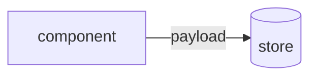

# Plan format

The shape of `plan.md` — the single executable plan `/blueprint` writes into the suite directory. There is exactly one plan file per suite; there are no chunks, no index, and no status machinery. `/build` consumes this file as its contract, the `gap-finder` goldfish review it cold, and `render.sh` turns it into `visual.html` without an agent — so the section names and line shapes below are parsed, not just read.

## Schema

````markdown
---
artifact: plan
title: <task title>
context: ./context.md
created: <YYYY-MM-DD>
---

# Plan: <task title>

## Context

<Restated problem with every assumption resolved. Self-contained: the executor reads this file with no prior conversation context.>

## Approach

<Chosen approach in 2–4 sentences.>

## Decisions

- (chosen) <name> — <what was decided and why>
- (rejected) <name> — <the alternative and why it lost>

## Architecture



## Files changed

- `<path>` (add) — <one-line intent>
- `<path>` (modify) — <one-line intent>
- `<path>` (delete) — <one-line intent>

## Phases

### Phase 1 — <name>

1. <Step detailed enough that an executor with no prior context can do it. Follow the code-in-plans rule strictly.>
2. <step>

### Phase 2 — <name>

1. <step>

## Risks & edge cases

- (high) <risk> → <mitigation>
- (low) <risk> → <mitigation>

## Acceptance criteria

- [ ] AC-1: <objective, mechanically verifiable criterion>
- [ ] AC-2: <criterion>
````

## Rules

- **Required:** the YAML frontmatter with all four keys, and `## Context`, `## Approach`, `## Files changed`, `## Phases`, `## Risks & edge cases`, `## Acceptance criteria`.
- **Optional:** `## Decisions` (whenever the interview settled a design choice — always when a gate criterion fired) and `## Architecture`. Omit them when empty — no placeholder headers. No other sections; anything else the executor needs belongs in `## Context`.
- **Line shapes are a parser contract.** Exact punctuation matters — `render.sh` renders a section that breaks its shape raw, under a visible warning:
  - Decisions: `- (chosen|rejected) <name> — <why>` (em dash).
  - Files changed: `` - `<path>` (add|modify|delete) — <intent> `` (em dash).
  - Phases: `### Phase <n> — <name>` followed by a numbered list. A step may continue on indented lines.
  - Risks: `- (high|medium|low) <risk> → <mitigation>` (arrow, not colon — colons appear in prose).
  - Acceptance criteria: `- [ ] AC-<n>: <criterion>`.
- **Zero design decisions left to the executor.** Every design choice is settled in `## Approach` or `## Decisions`; the executor chooses implementation details only. The comprehension goldfish checks exactly this.
- **Text, plus at most one diagram.** `## Architecture` holds one small mermaid `flowchart` with explicit, labeled edges — only when the shape of the change is easier to see than to read. No other diagrams, no HTML. The executor reads every token; a task that needs more than one diagram is too big for one blueprint.
- **Phases, not chunks.** A phase is an ordered group of steps with a natural checkpoint after it (builds, tests pass, a layer is complete). Small plans have one phase. The executor runs all phases in one session, reporting at each boundary.
- **`AC-n` IDs are stable and sequential.** The executor's report references them by ID. Never renumber existing items when revising — append.
- **Severities are stated, never inferred downstream.** Every risk carries a leading `(high|medium|low)`. The renderer shows a missing one as unrated.
- **Mechanical criteria only.** `## Acceptance criteria` covers what the executor can verify from the inside: compiles, migration runs, flag exists, tests pass. Behavioral intent — does the feature do what the user asked — belongs to `qa-plan.md` and is deliberately kept out of this file.

## Code in plans — strict rule

Plans are interface contracts and intent. The executor designs implementation.

### Include

- **Reference snippets** from existing code (≤10 lines) showing patterns the executor should follow
- **Interface specifications**: function signatures, type definitions, schema fields, API contracts
- **Pseudocode** for non-obvious algorithmic decisions (≤5 lines, only when prose would be ambiguous)

### Do NOT include

- Implementation bodies (function internals, error message strings, validation logic, control flow)
- Constants or magic numbers — name the concept, let the executor pick the value
- Anything the executor would write themselves given the interface spec

### Negative example (do not do this)

```ruby
def validate_segment!(name, value)
  raise ArgumentError, "#{name} must be a String" unless value.is_a?(String)
  raise ArgumentError, "#{name} can't be blank" if value.strip.empty?
  INVALID_CHARS.each do |c|
    raise ArgumentError, "#{name} cannot contain '#{c}'" if value.include?(c)
  end
  raise ArgumentError, "#{name} contains control chars" if value =~ /[[:cntrl:]]/
end
```

### Positive example (do this instead)

> Add `Topics.validate_segment!(name, value)`: raises `ArgumentError` if value is not a String, is blank, contains MQTT wildcards (`+`, `#`, `/`), or contains control characters. Used by `installation_sync` to validate inputs.

If you find yourself writing more than ~5 lines of new implementation code, stop and convert to prose specification.
